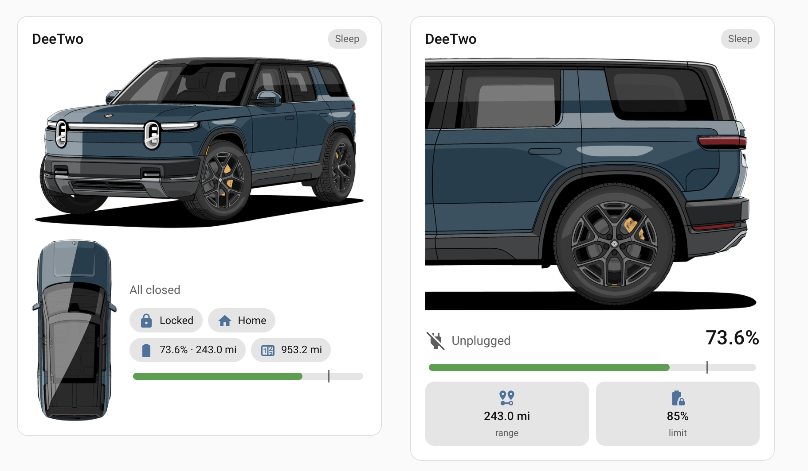

# Rivian R2 Card

A Home Assistant dashboard card for the **Rivian R2**: a status view that lights up open doors, windows, the frunk, the liftgate and the R2's drop-down rear glass, plus a charging view.



Built for the R2 specifically: no gear tunnel, tonneau, tailgate or powered charge-port door, which the R2 doesn't have. For the R1T and R1S, see [tmack8001/ha-rivian-card](https://github.com/tmack8001/ha-rivian-card), which inspired this card.

## Requirements

- The [Rivian (Unofficial)](https://github.com/bretterer/home-assistant-rivian) integration, with vehicle images enabled (the default). The card uses the integration's image entities, so the car is shown in **your** color and wheels. No images are bundled here.
- Home Assistant 2024.8 or newer.
- No other frontend cards. card_mod and bar-card are **not** needed.

## Install

**HACS (custom repository):**

1. HACS → ⋮ → *Custom repositories* → add `https://github.com/jabella/rivian-r2-card`, type **Dashboard**.
2. Install **Rivian R2 Card**, then reload your browser.

**Manual:** copy `rivian-r2-card.js` to `config/www/` and add it as a dashboard resource (`/local/rivian-r2-card.js`, type *JavaScript module*). After updating the file, change the resource URL (e.g. `/local/rivian-r2-card.js?v=0.1.2`) so browsers and the companion app load the new version.

## Configure

The card finds your R2 and its entities automatically. There are no entity IDs to edit.

```yaml
type: custom:rivian-r2-card
view: status        # or: charging
```

```yaml
type: custom:rivian-r2-card
view: charging
```

### Options

| Option | Default | Description |
|---|---|---|
| `view` | `status` | `status` (overhead closures + status chips) or `charging` |
| `device_id` | first R2 found | Pick a vehicle if you have more than one Rivian |
| `title` | vehicle name | Header text, or `false` to hide it |
| `show_status` | `true` | Lock / location / battery / odometer chips in the status view |
| `theme` | follows HA | `dark` or `light` to force a render style |
| `hero_image`, `overhead_image`, `side_image` | auto | An `image.*` entity or URL to use instead |
| `entities` | auto | Override any entity, e.g. `entities: { soc: sensor.my_soc }` |

Overridable entity roles: `lock`, `soc`, `range`, `odometer`, `charging`, `plugged`, `limit`, `elapsed`, `remaining`, `rate`, `cost`, `energy`, `range_added`, `cabin_temp`, `preconditioning`, `power_state`.

### How entities are found

Instead of guessing entity IDs, the card reads the entity registry and matches the integration's translation keys on your R2's device (e.g. `binary_sensor` + `closure_liftgate_closed`). Renamed entities and custom vehicle names keep working.

## What it shows

**Status:** frunk, four doors, four windows, liftgate, rear glass, lock state, home/away, state of charge and range, odometer and preconditioning, with a charge bar that marks your charge limit. Open doors swing out on the overhead render; tap anything for its more-info dialog.

**Charging:** plugged / charging state, state of charge with limit marker and, while plugged in, limit, rate, elapsed, remaining, energy delivered, range added and cost. The side render shows the charge cable only when the car is actually plugged in.

## Credits

- [tmack8001/ha-rivian-card](https://github.com/tmack8001/ha-rivian-card) and its contributors for the original R1 card and concept.
- [bretterer/home-assistant-rivian](https://github.com/bretterer/home-assistant-rivian) and contributors for the integration and its R2 support.

Not affiliated with or endorsed by Rivian. MIT licensed.
